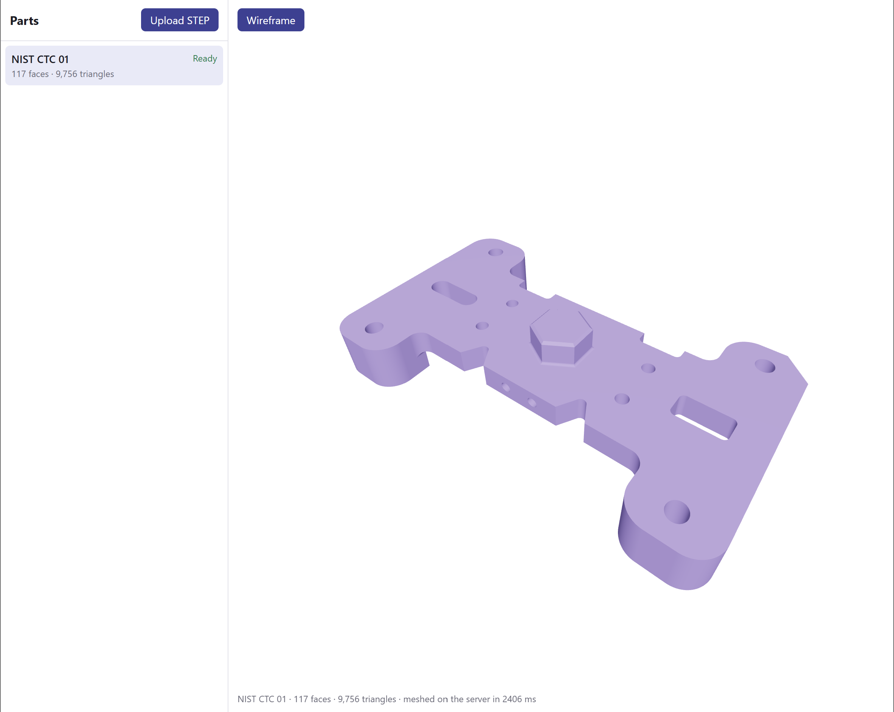

# CAD Viewer

[](https://github.com/guayabas/CAD-Viewer-Completed/actions/workflows/ci.yml)

- **Demo (instant):** https://guayabas.github.io/CAD-Viewer-Completed/ (open or drop a STEP file; it's meshed in your browser and never uploaded)
- **Full app:** https://cad-viewer.onrender.com (uploads are meshed on the server and saved in Postgres; the free instance takes about a minute to wake up after 15 minutes idle)



Upload a CAD file (STEP), mesh it with Open CASCADE, store it in Postgres, and view it in the browser with React Three Fiber. The meshes keep their **B-rep face IDs**, so a click on a triangle can be traced back to the CAD face it came from: the base for marking inspection regions or defects on a part.

## Architecture

```
browser (React + R3F)
  │  POST /parts (multipart STEP)          GET /parts/:id (poll every 1.5 s)
  ▼                                          ▲
Rails 8 JSON API (Puma) ──────────────────────┘
  │  saves the file (Active Storage: disk in dev, Backblaze B2 in prod)
  │  creates Part(status: pending), queues TessellatePartJob, answers 201 right away
  ▼
Solid Queue worker (runs inside Puma) ── status: processing
  │  tessellator in.step out.glb --meta out.json   (with a timeout)
  ▼
tessellator (C++17, OCCT 7.6): STEP → GLB + JSON (bbox, counts, timings, face map)
  │
  ▼
Tessellation row + GLB attached ── status: ready (or failed + error_message)
  │
  ▼
viewer loads glb_url and the face map
```

| Folder | What it is |
|---|---|
| `tessellator/` | C++ CLI: `tessellator <in.step> <out.glb> [--rel-deflection 0.01] [--angular 0.1] [--meta out.json]`. Exit codes: 0 ok, 1 read error, 2 usage error, 3 mesh/export error; errors on stderr. |
| `web/` | Rails 8.1 JSON API: `POST /parts`, `GET /parts`, `GET /parts/:id`. Postgres, Solid Queue, Active Storage. In production it also serves the viewer. |
| `viewer/` | Vite + React + TypeScript + React Three Fiber. Two modes, picked at build time (below). |
| `samples/` | NIST CTC 01 STEP file (public domain), used by the tests and the seed. |

**One viewer, two modes.** Without `VITE_API_URL` the viewer is a static **demo** for viewing (GitHub Pages): it opens the bundled NIST part, local `.glb` files, and local STEP files meshed in the browser by [occt-import-js](https://github.com/kovacsv/occt-import-js) (OCCT compiled to WebAssembly, run in a Web Worker so the page stays responsive). With `VITE_API_URL` it is **connected**, for saving: parts list, upload with progress (button or drag and drop), status polling, and the GLB loaded from Rails. Both paths produce the same face map shape (`{id, first, count}` per face), so the viewer treats them alike.

## Data model

```
parts                              tessellations
─────────────────────────          ───────────────────────────────────
id                                 id
name            string  not null   part_id             fk, indexed, not null
file_format     string  not null   rel_deflection      float  not null
status          int     not null   linear_deflection   float  not null (m)
                (indexed)          angular_deflection  float  not null (rad)
error_message   text               triangle_count      int    not null
+ source_file (Active Storage)     face_count          int    not null
                                   bbox                jsonb  not null
                                   face_map            jsonb  not null
                                   timings             jsonb  not null
                                   occt_version        string
                                   + glb (Active Storage)
```

Decisions:

- **Parts and tessellations are separate tables.** A part is the CAD file someone uploaded; a tessellation is one meshing of it at given settings. One part can have several quality levels (a coarse mesh for the browser, a fine one for rendering synthetic training images), and re-meshing with a better tessellator doesn't touch the part. The API shows `Part#latest_tessellation`.
- **`status` is an integer enum** (`pending 0 → processing 1 → ready 2 / failed 3`) with an index, because the obvious queries are "what's still processing" and "what failed". Rails maps the integers to names and adds `part.ready?`, `Part.failed`, etc. A failure keeps a readable `error_message` (the tessellator's stderr, with the temp path replaced by the uploaded file's name) so a user sees why, not just that.
- **`file_format`, not `format`**: `format` is a Ruby built-in (`Kernel#format`) and clashes on the model. The column allows `step`/`iges`/`brep`; uploads accept only `.step`/`.stp` until the tessellator reads the others.
- **jsonb for `bbox`, `face_map` and `timings`.** They are always read whole, together with the row, never filtered or joined on, and their shape comes from the tessellator. A `faces` table with one row per B-rep face would be thousands of rows per part for no query that needs it. If the app later needs "all parts with a face larger than X", that is when it becomes a table.
- **Face IDs are kept.** The face map lists, per glTF primitive, each B-rep face's triangle range. That turns a triangle hit in the browser back into a CAD face, so a user picks a face, not a triangle. That is the base for the next table, **`inspection_regions`** (`part_id`, `face_ids`, `label`): saved faces where defects are checked or labeled.
- **Settings and versions are stored with the mesh** (`rel_deflection`, the resulting `linear_deflection`, `occt_version`), so any mesh can be reproduced and compared.
- **Files live in Active Storage**, not in Postgres: the database stays small, and in production the GLB is served from a short-lived signed storage URL instead of being streamed through Rails.

## Tessellation

- **Reading:** `STEPCAFControl_Reader` into an XCAF document, keeping names, colors and the assembly.
- **Deflection is relative to the model's size.** Linear deflection = `rel_deflection` × the bounding-box diagonal (default 1%), angular = 0.1 rad. A fixed value in mm would be too coarse for a 10 mm screw and far too fine for a 2 m frame.
- **Normals from the exact surface.** `RWGltf_CafWriter` computes them from the B-rep surface (not by averaging triangles) and flips them for reversed faces, so curved faces shade smoothly and sharp edges stay sharp. Precomputing them with `BRepLib::EnsureNormalConsistency` looks equivalent but stores unflipped surface normals, which inverts every reversed face; checked by comparing normals with triangle winding.
- **Units:** OCCT works in mm with Z up, glTF in meters with Y up. The writer converts both (a 10 mm cube comes out 0.01 m), and the bbox in the JSON is in the same frame as the GLB.
- **Face map by construction.** `FaceMapWriter` subclasses `RWGltf_CafWriter` and overrides `saveIndices`, which the writer calls once per face while it appends that face's triangles. The map comes from the same loop that writes the GLB, so it can't fall out of sync with it.
- **One primitive per part** (`SetMergeFaces`): one draw call per part instead of one per face; the face map keeps the per-face information.

## Running locally

Ubuntu 24.04 (or WSL). Needs OCCT 7.6, Ruby 3.4, Postgres and Node LTS.

```bash
# 1. Tessellator
sudo apt install cmake g++ libtbb-dev occt-misc \
  libocct-foundation-dev libocct-modeling-data-dev libocct-modeling-algorithms-dev \
  libocct-ocaf-dev libocct-data-exchange-dev libocct-visualization-dev libocct-draw-dev
cmake -S tessellator -B tessellator/build -DCMAKE_BUILD_TYPE=Release
cmake --build tessellator/build
tessellator/build/tessellator samples/nist_ctc_01_asme1_ap242-e1.stp /tmp/out.glb --meta /tmp/out.json

# 2. Rails API on :3000 (development runs jobs in-process)
cd web
bundle install
bin/rails db:prepare             # creates the database; the seed meshes the NIST sample
bin/rails server

# 3. Viewer on :5173
cd viewer
npm install
npm run dev                                      # demo mode
VITE_API_URL=http://localhost:3000 npm run dev   # connected mode
```

**Tests:** `bin/rails test` in `web/` covers the models and upload limits, the CLI wrapper (fake shell-script binaries for errors and timeouts), the job (the real tessellator on the NIST sample) and the API. CI (`.github/workflows/ci.yml`) builds the tessellator on Ubuntu 24.04 and runs those tests against Postgres, plus RuboCop, Brakeman, and the viewer's lint and build.

## Deploy

| Piece | Where | Why |
|---|---|---|
| Demo viewer | GitHub Pages, built by `.github/workflows/pages.yml` | static, free, always on |
| Rails + tessellator + connected viewer | One Docker image on a Render free web service (`render.yaml`) | free; sleeps after 15 min idle, ~1 min to wake |
| Postgres | Neon free tier | Render's free Postgres is deleted after 30 days |
| Files | Backblaze B2 (S3 API) | 10 GB free with no card and hard $0 caps |

- **Dockerfile (repo root):** every stage starts from the same Debian bookworm Ruby image, so the tessellator is compiled against the exact OCCT 7.6.3 the final image runs, and the final image installs only the OCCT runtime libraries. The viewer is built in connected mode (`VITE_API_URL=/`) and served by Rails from the same origin, so the deployed app needs no CORS.
- **Solid Queue runs inside Puma** (`SOLID_QUEUE_IN_PUMA=true`): Render's free tier has no background workers. One job at a time, because the instance has 512 MB.
- **One database.** Solid Queue's tables live in the main Neon database instead of the default separate `queue` database: one connection string, one free-tier database, and a job is enqueued in the same transaction as its part. Solid Cache and Solid Cable are removed; nothing uses them.
- **Public uploads are limited:** `.step`/`.stp` only, 50 MB per file (also checked from `Content-Length` before parsing), 10 uploads per minute per IP (`rate_limit`), a 120 s tessellator timeout, at most 200 uploads per day, and a 5 GB total storage quota (half of B2's free tier). B2's own caps are set to $0, so the worst case is a paused demo, never a bill.
- **Startup:** `bin/docker-entrypoint` runs `db:prepare` (migrations) and `db:seed` (adds the NIST part if it's missing) before Puma starts.

Environment variables on Render: `RAILS_MASTER_KEY`, `DATABASE_URL` (Neon, direct connection), `S3_ENDPOINT`, `S3_REGION`, `S3_BUCKET`, `S3_ACCESS_KEY_ID`, `S3_SECRET_ACCESS_KEY`. Optional: `STORAGE_QUOTA_MB`, `DAILY_UPLOAD_LIMIT`, `TESSELLATOR_TIMEOUT`, `TESSELLATOR_REL_DEFLECTION`, `TESSELLATOR_ANGULAR_DEFLECTION`. The B2 bucket needs a CORS rule allowing GET from the app's URL, because the GLB is downloaded straight from B2.

## Next

- **Face picking:** raycast → triangle index → binary search in the face map → highlight the B-rep face's triangles.
- **B-rep edges as lines:** export each edge's polyline (`BRep_Tool::PolygonOnTriangulation`) next to the GLB and draw it with `LineSegments`.
- **`inspection_regions`:** save picked faces with a label (defect type, inspection zone) per part.
- **More formats and quality levels:** IGES and BREP readers; a coarse and a fine tessellation per part.

## Credits

- [Open CASCADE Technology](https://dev.opencascade.org/) (LGPL-2.1 with an exception) for reading, meshing and glTF export.
- [occt-import-js](https://github.com/kovacsv/occt-import-js) by Viktor Kovacs (LGPL-2.1), OCCT compiled to WebAssembly, loaded unmodified for in-browser meshing.
- NIST CTC 01 test model from the NIST MBE PMI Validation and Conformance Testing project (public domain in the US); see `samples/README.md`.
- [three.js](https://threejs.org/), [React Three Fiber](https://r3f.docs.pmnd.rs/) and [drei](https://github.com/pmndrs/drei) (MIT).
